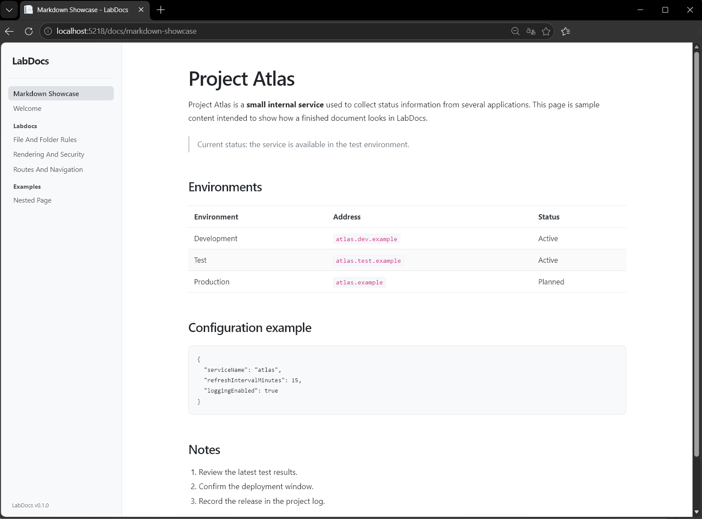

# LabDocs

LabDocs is a small ASP.NET Core application that turns a directory of Markdown files into a navigable documentation site.



## Features

- Filesystem-based Markdown content
- Navigation generated from files and nested folders
- Predictable routes based on file paths
- Tables, task lists, code blocks, and other common Markdown features
- Sanitized HTML output with raw HTML disabled
- Internal pages for missing content and unexpected errors


## Built with

- [ASP.NET Core](https://learn.microsoft.com/aspnet/core/) for the web application
- [Markdig](https://github.com/xoofx/markdig) for CommonMark-compatible parsing and advanced Markdown extensions
- [HtmlSanitizer](https://github.com/mganss/HtmlSanitizer) for filtering generated HTML before it is rendered


## Requirements

- [.NET 10 SDK](https://dotnet.microsoft.com/download/dotnet/10.0)

## Run LabDocs locally

Clone the repository and start the web project:

```powershell
git clone https://github.com/Valtzzu/LabDocs.git
cd LabDocs
dotnet run --project LabDocs/LabDocs.csproj
```

Open the address shown in the terminal. With the included development profile, the HTTP address is `http://localhost:5218`.

## Add documentation

Place Markdown files inside [`LabDocs/content`](LabDocs/content). LabDocs searches this directory recursively and uses its folder structure to build the navigation.

Files and folders must use lowercase kebab-case:

```text
content/
├── welcome.md
└── getting-started/
    └── first-page.md
```

The example above creates these routes:

```text
/docs/welcome
/docs/getting-started/first-page
```

Each path segment may contain lowercase letters and numbers separated by single hyphens. Spaces, underscores, uppercase letters, repeated hyphens, and `.md` extensions in URLs are not accepted.


## Security

LabDocs applies several checks at the content boundary:

- Slugs only accept lowercase kebab-case path segments, preventing `..` traversal and rooted paths.
- Resolved page paths must remain inside the configured content directory.
- Symbolic links and Windows directory junctions are rejected in the content directory.
- Raw HTML inside Markdown files is disabled.
- Generated HTML is sanitized before it is rendered.

These safeguards reduce the risk of unintended file access, executable markup, unsafe attributes, and dangerous URLs. The content directory should still only be writable by trusted administrators, and documentation changes should be reviewed like other source-code changes.

## Project structure

```text
LabDocs/
├── LabDocs/          Web application and Markdown content
├── LabDocs.Tests/    Automated tests
└── LabDocs.slnx      .NET solution file
```

The application starts in [`Program.cs`](LabDocs/Program.cs). Content discovery, routing support, title formatting, and Markdown rendering are implemented in [`LabDocs/Services`](LabDocs/Services).

## Run the tests

From the repository root:

```powershell
dotnet test LabDocs.slnx
```

## Current limitations

- Content is edited directly as files; there is no browser-based editor.
- There is no authentication or per-page access control.
- There is no built-in search.
- Front matter and other page metadata are not supported.
- Automated cross-platform testing is not configured yet. Path handling is platform-aware, but releases should be tested on each target operating system.
- Markdown content and generated navigation are not cached. Files are read and navigation is rebuilt for each request, which keeps content changes immediate but may add filesystem and rendering overhead on larger or busy sites.

## License

LabDocs is available under the [MIT License](LICENSE).
